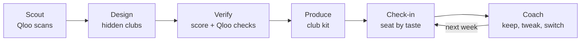

# Kindling

Where strangers become regulars.

Kindling is an AI agent that turns a venue's empty weeknight into a weekly club for people with the same taste. It reads your city's taste, the places within 1 km and your venue's own crowd with the Qloo taste API, designs and scores the clubs, writes the kit, seats guests by taste at check-in, and re-tunes the plan every week from who actually came back.

- Live site: https://kindling-sand-eight.vercel.app/ (deploy notes in DEPLOY.md)
- Source: https://github.com/sahil-makandar/kindling
- Licence: MIT, see `LICENSE`
- Built for the Qloo Agentic Hackathon

## The problem

- Only 6% of restaurant reservations are for Monday nights and 8% for Tuesday (Toast data): https://www.chowhound.com/1841628/why-restaurants-closed-on-mondays
- 1 in 6 people is affected by loneliness (WHO Commission on Social Connection, 2025): https://www.who.int/groups/commission-on-social-connection
- It takes about 50 hours together to go from acquaintance to casual friend (Jeffrey Hall, 2018): https://news.ku.edu/2018/03/06/study-reveals-number-hours-it-takes-make-friend

One-off events cannot reach 50 hours. The same people, in the same place, every week can.

## What it does

1. **Scout.** You give an address and your slowest night. The Scout, a model-driven tool loop, reads what people near the venue love in film, music, TV, books and podcasts, what is rising, which places are around, and what the crowds of similar venues like. It widens the search when data is thin and writes a reason for every call.
2. **Design.** The Designer proposes 6 to 8 hidden clubs (for example a film anchor with a music companion and a nearby place). Everything it cites must exist in the Scout's results, and code drops anything that does not.
3. **Verify.** The Verifier checks the top clubs with more Qloo calls and scores every club with a fixed formula. Each part of the score comes with a reason and the exact Qloo calls behind it.
4. **Produce.** The Producer writes the kit: poster with a check-in QR code (print or PNG), run of show, listing copy, playlist, menu special, trivia and a table tent. A licence note appears whenever a text mentions screening a film.
5. **Run the night.** Guests scan the QR code, give a first name and pick three favourites. Qloo reads the tags of those favourites, and the Seater puts people with real overlap at the same table ("You all love: ..."). The host sees the tables live.
6. **Re-tune weekly.** The Coach reads attendance, who returned and the room's combined taste, then recommends keep, tweak or switch with the numbers in the reasons. The weekly page counts **regulars made** (people who came three or more times).

Every run also shows a **Without Qloo** comparison: the same question put to a plain language model with no Qloo data, scored against the area's real results.

## Why it only works with Qloo

A language model on its own says "host a trivia night". Qloo knows what your city loves, what is rising there, which places sit within 1 km of your door, which things belong together, and what each guest's favourites say about their taste. Remove Qloo and every club in this app becomes a generic guess, and the seating has nothing to match on.

## The loop



| Role | What it does | Model or code |
|---|---|---|
| Locator | Finds the venue on Qloo and reads its tags | Code |
| Scout | Chooses which Qloo scans to run, with a budget and a radius ladder | Model tool loop, with a standard plan as fallback |
| Designer | Proposes clubs from the Scout's pool | Model, validated by code |
| Verifier | Coherence calls and the club score | Code and Qloo |
| Producer | Club kit | Model, validated by code (playlist and licence note are code) |
| Seater | Tables from weighted tag overlap | Pure code |
| Coach | Decision from fixed rules, wording from the model | Code and model |
| Baseline | The no-Qloo comparison | Model |

## Qloo usage

All Qloo calls go through `src/qloo/client.ts`: GET only, a path allow-list, 340 ms pacing, one retry on 429, a 15 s timeout, a cache in Postgres, and a log of every call (endpoint, parameters, status, time, result count, cached) that powers the "How we know" evidence drawer. The live counts per purpose are on the How it works page at `/how`.

| Where | Endpoint | What it asks | Why |
|---|---|---|---|
| Locate | `/search` | The venue by name | Its own tags and crowd |
| Scout | `/v2/insights` (entity types) | `signal.location` with a radius, per domain, twice (biggest and more local) | What the area loves |
| Scout | `/v2/insights` (tags) | `signal.location` | The vibe of the area's places |
| Scout | `/v2/insights` | Places like the venue as the signal | What the venue's crowd loves |
| Scout | `/v2/insights` | `bias.trends` | What is rising |
| Scout | `/v2/insights` (places) | `signal.location` | Nearby places that fit |
| Verify | `/v2/insights` (score list) | The anchor as signal, companions as the list | Whether a club fits together |
| Verify | `/v2/insights` (heatmap) | The winning club's anchor | Where its taste is strongest |
| Check-in | `/search` | Film, music, shows, books, podcasts by name | Autocomplete |
| Check-in | `/entities` | The three favourites by id | A guest's taste vector |
| Coach | `/entities`, `/v2/insights` | The club's theme by id, and entities near the venue | Drift and next week's fresh sub-theme |

Findings from running against the live API are written up in `docs/QLOO_API.md` (section 8): popularity bands, what `signal.location` returns, why genre tags from the favourites themselves seat people better than the tag insight, and where Qloo's media taste is city-wide. The How it works page states the locality caveat plainly.

Qloo data rule: no Qloo response data is stored in this repository. `fixtures/sample/` holds hand-written sample data whose ids all start with `fx_`. Real responses are only ever kept in the private database cache.

## Architecture

```
app/                    Next.js routes: pages and thin API handlers
  runs/[id]             live agent run, with the trace and map
  runs/[id]/clubs       club picks with the evidence drawer
  clubs/[id]            club kit: poster, run of show, listing, QR
  clubs/[id]/live       host view: tables, waiting list, close the night
  clubs/[id]/weeks      weekly report and the Coach
  c/[code]              guest check-in (mobile)
  how, sample, venues  how it works, the sample venue, and your venues
  api/                  runs, clubs, check-in, search, sessions, recommendations
src/
  config/               brand constant, validated environment
  qloo/                 client, endpoints, schemas, tags, offline fixtures loader
  agent/                locator, scout, designer, verifier, producer, baseline, llm layer, prompts
  scoring/              the club score (pure)
  seating/              taste vectors and table assignment (pure)
  coach/                signals, decision rules, recommendations, weekly report
  checkin/ clubs/ runs/ the logic behind the routes
  demo/                 the demo venue seed
  db/                   Drizzle schema and client
  ui/                   shared components
fixtures/sample/        hand-written sample data
scripts/                Qloo spike, demo seed, copy lint
tests/                  Vitest, no network
docs/                   planning docs
```

Stack: Next.js (App Router), TypeScript in strict mode, Tailwind CSS, the Vercel AI SDK with a swappable free-tier-first provider chain (Gemini, then OpenRouter), Zod on every external input and every Qloo or model response, Postgres on Neon with Drizzle, Leaflet with OpenStreetMap tiles, Nominatim for geocoding (cached, one request a second), `qrcode` and `html-to-image`.

Each agent stage is its own request (`maxDuration` 60 s), so no single request runs long. A run is a small state machine in the database; refreshing the page picks it up where it is.

## Run it locally

Needs Node 20.9 or newer and a Postgres database (a free Neon project works).

```bash
npm install
cp .env.example .env.local     # set DATABASE_URL
npm run db:migrate
npm run dev                    # http://localhost:3000
```

The defaults (`QLOO_MODE=fixtures`, `LLM_MODE=mock`) need no API keys. The app shows a banner whenever it runs on sample data.

| Variable | Needed for | Notes |
|---|---|---|
| `DATABASE_URL` | Always | Neon pooled connection string |
| `QLOO_MODE` | Always | `fixtures` (offline), `live` (real API), `record` (live and saves raw responses to the git-ignored `fixtures/live/`, local only) |
| `QLOO_API_KEY`, `QLOO_BASE_URL` | `live` and `record` | The hackathon key only works on `https://hackathon.api.qloo.com` |
| `LLM_MODE` | Always | `mock` (canned) or `live` |
| `LLM_PROVIDER`, `LLM_FALLBACK_PROVIDERS`, `LLM_MODEL`, `LLM_MODEL_FAST` | `live` | `google` or `openai-compatible` (Groq is supported but not in the default chain); models come from the environment, never the code |
| `GOOGLE_GENERATIVE_AI_API_KEY`, `GROQ_API_KEY`, `OPENAI_COMPATIBLE_*` | `live` | Only the providers you use |
| `RATE_LIMIT_PER_HOUR` | Optional | New runs per IP per hour, default 30. Reused runs never count |
| `NOMINATIM_USER_AGENT` | Optional | Identifies the app to Nominatim |

```bash
npm run dev            # local server
npm run check          # typecheck, eslint, copy lint, tests
npm run build          # production build
npm run db:seed-demo   # builds the fictional sample venue with four simulated weeks
npm run qloo:spike     # live probe of the Qloo API; raw responses stay on your machine
```

To build the real demo, run `QLOO_MODE=live npm run db:seed-demo -- --force`. It runs a real agent run, makes a club, and adds four simulated weeks seated by the real seating code.

## Tests

`npm test` runs about 580 Vitest tests with no network and no database. They cover the Qloo client (pacing, retry, cache, path allow-list), the schemas against the real response shapes, the Scout loop and its budget, the Designer's grounding rules, the club score, the seating (clusters, nobody alone, regulars spread, determinism, latecomers), check-in (consent, timeout fallback, closed sessions, the device cookie), the Coach's signals and decisions, the API error mapping and rate limit, the copy lint, and a guard that keeps the product name in one file.

## Privacy and data honesty

- Guests give a first name or nickname. No email or phone number.
- Qloo receives only entity ids, tag ids and coordinates. A guest's name never leaves our database.
- The language model receives only numbers and tag names for a room, never a name or one person's picks.
- A cookie recognises a returning guest only after they tick a box, and holds a random code.
- "Forget me" on the check-in confirmation deletes the guest and every check-in linked to them.
- The sample venue is fictional and its four weeks are simulated. Every page that shows them says so.
- Trivia is drafted by a language model and marked "Check before use".
- When no model answers, the page says the wording came from a template. Scores, seating and decisions are computed by code either way.

## Limitations

- Qloo's film, music, TV, book and podcast taste is city-wide. What makes a pick local is the places near the venue, the venue's own tags and the popularity band.
- Coverage outside the US depends on Qloo's data for that city.
- The free language model tiers are sometimes busy, so wording can fall back to templates.
- Session dates are UTC calendar dates, so a venue far from UTC may see the date shift by a day.
- Showing a full film in public needs a licence. The kit never plans a screening.

## Licence

MIT. See `LICENSE`.
